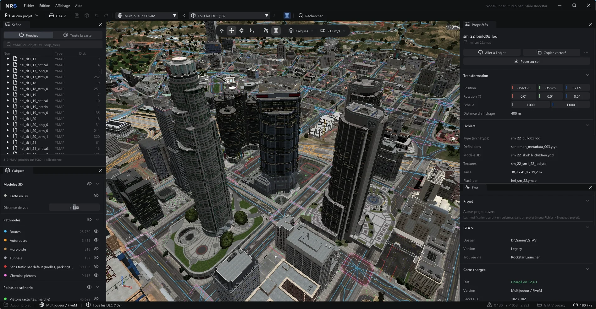
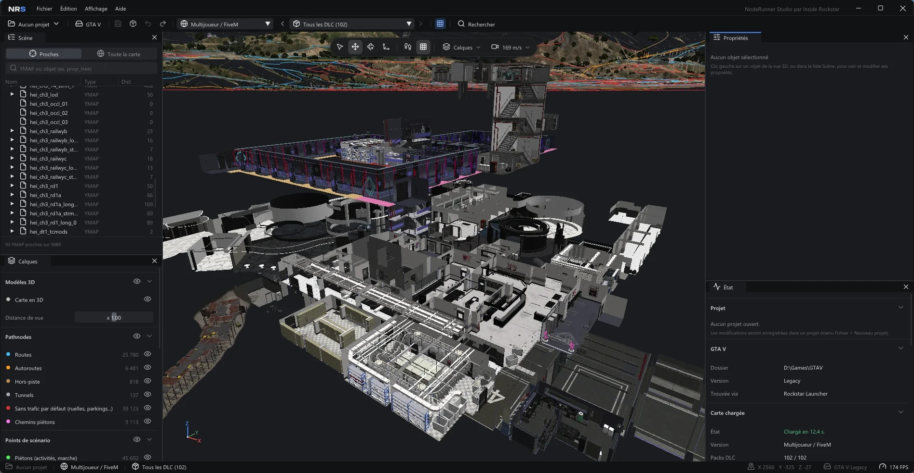

<h1 align="center">NodeRunner Studio</h1>

<p align="center"><strong>Build your own Los Santos.</strong><br>Create, edit, explore and test GTA V maps in one 3D studio.</p>

<p align="center">
  <a href="https://github.com/HypnoZDev/NodeRunner/releases/latest"></a>
</p>
<p align="center">
  <a href="https://github.com/HypnoZDev/NodeRunner/releases/latest"></a>
  
  
  
  
</p>
<p align="center"><a href="README.md">Français</a> · <strong>English</strong> · <a href="https://github.com/HypnoZDev/NodeRunner/releases">Release history</a></p>



**Picture this:** open GTA V in NodeRunner, move a building, create an interior, place furniture with your mouse and remove unwanted collisions. Hit Play to walk through your creation. Then see it in FiveM through the live link with your local test server.

Less switching between tools. Less repetitive work. More time to create.

> **NodeRunner Studio 2.0 — a new dimension for mapping.** Free for non-commercial use, portable, no installation required, available in English and French.

---

## Game-changing features

| | |
| :--- | :--- |
| **🎮 Your map, live in FiveM**<br>Connect NodeRunner to your local development server. Follow the in-game camera, teleport your character and preview edits live. Export and reload resources from the editor. | **🚶 Walk through your creation**<br>Play mode lets you walk, run, jump, climb and swim as a GTA V character. Collisions and occlusion help you spot blocked passages or disappearing objects. |
| **🌅 A new 3D renderer**<br>HDR, TAA, ambient occlusion, night lights, realistic skies, weather, waves and wet surfaces. Ray-traced reflections on compatible GPUs. | **🏗️ Automatic LOD generation**<br>Eligible large objects added to your map can receive simplified models and their corresponding LOD links at export time. |
| **🧩 Your own prop workshop**<br>Turn an image into a 3D prop with relief and collision, edit a model or its textures, then save it as a new prop. | **🔁 Blender, Sollumz and CodeWalker**<br>Import compatible XML assets and watch a Blender export folder. Export game assets as XML with DDS textures to continue working in your favourite tools. |
| **👥 Build together**<br>Up to five people in one project, with live edits, selections and cameras. Join with a session code. | **🛡️ Export with validation**<br>Detect resource conflicts, missing dependencies, MLO errors and oversized files before or after exporting. |

<p align="center"><a href="https://github.com/HypnoZDev/NodeRunner/releases/tag/v2.0.0"><strong>Explore all the 2.0 features →</strong></a></p>

## From your first prop to your map in game

| 1. Explore | 2. Build | 3. Test | 4. Deploy |
| :--- | :--- | :--- | :--- |
| Find a YMAP, model, hash or coordinates with `Ctrl+K`. | Place props, edit MLOs, roads and collisions. | Walk through your creation in Play mode or use Game Link. | Export a FiveM resource and validate dependencies. |

### A proper workshop for interiors



Create an MLO, duplicate an interior elsewhere on the map, manage rooms, portals, furniture and entity sets. Configure interior audio and inspect structural issues before exporting.

**A closed building?** The experimental *Open a building* tool can cut an opening into the model and its collision, with a simple room behind it. Refine the result in the workshop.

## A mapper's toolkit, all in one place

<details open>
<summary><strong>🗺️ Explore and edit the map</strong></summary>

- The full GTA V map, original models and textures, DLCs, levels of detail, single-player and multiplayer variants.
- Multi-selection, 3D transforms, snapping, copy/paste, undo/redo and edit history.
- Mouse placement on ground, roofs, tables or walls; mouse-wheel rotation and collision-aware placement.
- Assisted object removal with a preview of affected LODs, collisions and occlusion.
- Technical layers for YMAPs, collisions, navmesh, roads, scenarios and interiors.
- Model, vehicle, character, animation and cutscene viewers; search, favourites and locate instances on the map.
- RPF archive explorer: search, read and extract files from your own game installation.

</details>

<details>
<summary><strong>🏢 MLOs, collisions, doors and occlusion</strong></summary>

- Create, place and duplicate interiors; edit rooms, portals, entities and entity sets.
- Interior audio: ambience, echo, sound occlusion and audio data generated on export.
- MLO health checks: invalid portals, rooms without portals, missing models and other inconsistencies.
- YBN editing: select and remove surfaces, change materials and flags, add triangles or rectangles.
- Occlusion: visualise, edit and build assisted occlusion boxes; preview what they hide.
- Doors: replacement, opening arcs, checks, copy-ready FiveM scripts and qb-doorlock configuration.

</details>

<details>
<summary><strong>🚦 Roads, scenarios and world life</strong></summary>

- YND road editing: nodes, links, lanes, speed and traffic.
- Create and edit scenario points, schedules, probabilities, chains and clusters.
- Editable car generators, timecycle zones and LOD lights.
- YNV navmesh visualisation and checks (YNV editing is not yet available).
- Life simulation at scenario points; playback of YVR vehicle recordings.
- AWC sound viewer with playback, waveforms and WAV export; audio-zone visualisation.

</details>

<details>
<summary><strong>🛠️ Model workshop, prop library and external tools</strong></summary>

- Remove, move, duplicate or add model parts; replace or resize textures.
- Save a new independent prop without replacing its original in-game model.
- Generate 3D signs and logos with relief and collision from an image.
- Shared prop library with ZIP/folder packs, thumbnails, categories, favourites and drag-and-drop.
- Import FiveM maps and compatible OIV packages, with import reports and missing dependency checks.
- Compatible Sollumz / CodeWalker XML import: YDR, YTD, YBN, YTYP and YMAP.
- XML export: YDR, YDD, YFT, YTD, YBN, YMAP and YTYP, with DDS files where applicable.
- Watch a Sollumz folder to reload new Blender exports into your project.

</details>

<details>
<summary><strong>📦 Export, validation and collaboration</strong></summary>

- FiveM resources: generated `fxmanifest.lua`, `stream` folder, recalculated extents and automatic LODs for eligible objects.
- Pre-export checks for resource conflicts, roads, scenarios, navmesh and interiors.
- Post-export checks for missing files, duplicates, dependencies and oversized assets.
- Validate an existing FiveM resource independently of the current project.
- Single-player `dlc.rpf` export, multiple projects, copy positions as Lua/JSON/C#.
- Online beta: up to five participants, host saves, live selections and cameras.
- Automatic rescue copies of edits, customisable shortcuts and automatic updates.

</details>

<details>
<summary><strong>🌦️ 3D rendering and other GTA games</strong></summary>

- HDR lighting, TAA, ambient occlusion, bloom, shadows and night lights.
- Weather, volumetric clouds, rain, snow, thunderstorms, wet surfaces and animated water.
- Optional DXR ray-traced reflections on compatible hardware (reflected objects currently use average texture colours).
- Four graphics presets, render resolution, sharpening and camera settings.
- GTA IV and its episodes, original PC releases of GTA III, Vice City and San Andreas: **read-only** exploration.

</details>

---

## Download and get started

**[⬇ Download the latest NodeRunner Studio release](https://github.com/HypnoZDev/NodeRunner/releases/latest)**

1. Download `NodeRunner-x.y.z-win-x64.zip` from the latest release.
2. Extract it to a folder of your choice.
3. Run `NodeRunner.exe`. The studio detects your GTA V installation or asks for its location.

No additional .NET installation is required. Future updates can be started from NodeRunner; always save your changes first.

| Requirement | Details |
| :--- | :--- |
| OS | Windows 10 or 11, 64-bit |
| Graphics | DirectX 11-compatible GPU; optional DXR for ray-traced reflections |
| Game | Your own GTA V installation (Steam, Epic or Rockstar Games Launcher) |
| Compatibility | Legacy is the primary development target. Enhanced is detected but not fully validated. |

### Essential shortcuts

| Action | Default shortcut |
| :--- | :--- |
| Global search | `Ctrl+K` |
| Look / move | Right mouse button + mouse / `WASD` or `ZQSD` |
| Move up / down | `Space` or `E` / `C` |
| Select, move, rotate, scale | `1` / `2` / `3` / `4` |
| Snap to ground | `End` |
| Play mode | `Alt+P`, then `Esc` to return |
| Save | `Ctrl+S` |

Shortcuts are customisable, with a CodeWalker preset. To export: **File > Export as FiveM resource**, select your server's `resources` folder and add the suggested `ensure` line to `server.cfg`. For Game Link, use **Tools > Game link (FiveM)** on your local test server.

> [!IMPORTANT]
> NodeRunner Studio is in beta. Keep independent backups of your projects and resources, and test exports in game before deployment. Enhanced models, cloth and shattering vehicle glass are not fully supported by XML export. Play mode is available for GTA V; it does not replace validation in FiveM.

## Questions, bugs and ideas

The studio evolves with feedback from mappers. [Report a bug or suggest a feature](https://github.com/HypnoZDev/NodeRunner/issues). For map-related problems, include the NodeRunner version, game version, coordinates and a screenshot. See the [releases](https://github.com/HypnoZDev/NodeRunner/releases) and the [project specification](docs/cahier-des-charges.md) (in French).

If NodeRunner helps you create maps, a GitHub star and a share of this page help others discover the project.

## Build from source

With the [.NET 10 SDK](https://dotnet.microsoft.com/download/dotnet/10.0) and Git:

```powershell
git clone https://github.com/HypnoZDev/NodeRunner.git
cd NodeRunner
dotnet run --project src/NodeRunner.App
```

To build the portable ZIP: `./build/publish.ps1`.

## License and credits

NodeRunner Studio is created by **Inside Rockstar**. The software is free, with no paid or donor-only features. The source code is published for transparency under the [PolyForm Strict 1.0.0](LICENSE.md) license: non-commercial use only; no redistribution, sale or publication of modified versions without permission. The NodeRunner Studio name and NRS logo belong to Inside Rockstar. To share the software, share this page.

No game files are included. NodeRunner reads your own installation using its own code. Built for story mode and FiveM, it offers nothing for GTA Online and does not bypass anti-cheat.

Thanks to **dexyfex**, the [CodeWalker](https://github.com/dexyfex/CodeWalker) contributors and the GTA V modding community for their work documenting game formats.

Libraries and assets used: Dear ImGui (Omar Cornut, MIT), ImGui.NET (Eric Mellino, MIT), Vortice.Windows (Amer Koleci, MIT), DirectX Shader Compiler (Microsoft, University of Illinois / NCSA), Lucide (ISC, icons derived from Feather by Cole Bemis, MIT), and Unbounded (The Unbounded Project Authors, SIL Open Font License 1.1). Font licenses are included in `src/NodeRunner.App/Assets/Fonts/`.

> NodeRunner Studio and Inside Rockstar are not affiliated with Rockstar Games or Take-Two Interactive. Grand Theft Auto and GTA are trademarks of Take-Two Interactive.
