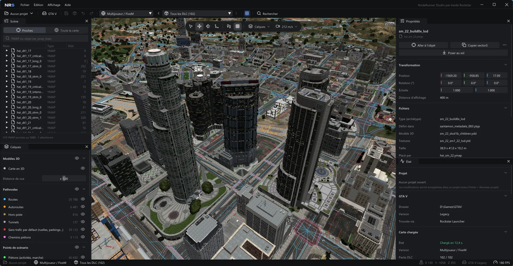
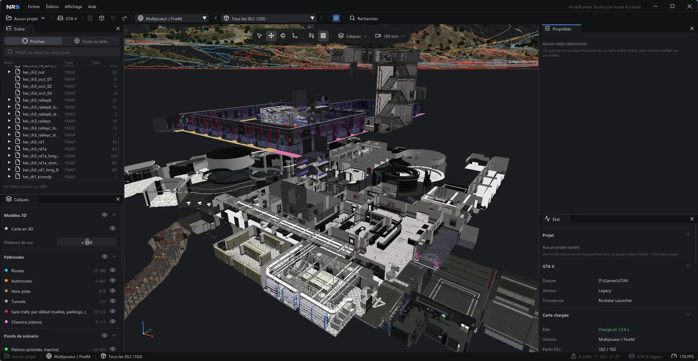

# NodeRunner Studio

[Français](README.md) · **English**

**The GTA V map in 3D, to explore it, understand it and edit it. Free, portable, built for FiveM mapping.**

<p align="center">
  <a href="https://github.com/HypnoZDev/NodeRunner/releases/download/v1.3.0/NodeRunner-1.3.0-win-x64.zip">
    
  </a>
  <br>
  <sub>Windows 10 / 11 64-bit · portable ZIP, nothing to install · <a href="https://github.com/HypnoZDev/NodeRunner/releases">all versions</a></sub>
</p>



If you've ever done mapping for a FiveM server, you know the routine: hunting for the right YMAP in CodeWalker, nudging
a Z value by the centimetre so an object doesn't float, recalculating extents, building the `stream` folder and the
`fxmanifest.lua` by hand... then finding an invisible wall in game where you deleted a building.

That's where NodeRunner Studio comes from. It's a map editor that takes care of those chores for you, with a real 3D
engine (shadows, water, time-of-day sky) to see the map as it really is.

> NodeRunner Studio is in **beta** and moving fast. It's already usable for real projects, but keep a copy of your
> resources before exporting over them.

> The interface is currently in French only.

---

## What it does

**Explore the map**
- The whole GTA V map in 3D, with the real models, textures, interiors (MLO), levels of detail, water, sun shadows and a
  day / night cycle.
- The map as it was after any DLC, in FiveM / multiplayer or single-player version.
- A `Ctrl+K` search that finds everything: an object, a YMAP, an archetype, a hash (`0x...`) or coordinates pasted from a
  script (`vector3(...)`, `vector4(...)`).
- Layers to show what's normally invisible: path nodes (traffic), navmesh (pedestrians), scenario points, collisions,
  interior rooms and portals.
- An **archive explorer**: every game file (RPF archives, DLC included) as a tree, name search, models opened in the
  viewer, YMAPs located on the map, text files displayed, extraction to disk.



**Edit**
- Click an object, move it, rotate it or scale it with the 3D gizmo (hold Ctrl to snap).
- **Snap to ground** with one key (End): the object lands on the game's real collision, interiors included.
- Multi-selection, copy / paste (`Ctrl+C` / `Ctrl+V`), unlimited undo / redo.
- Add any game object, picked in the model viewer (which also shows vehicles).
- **Clean deletion**: the object goes away with its levels of detail, its collision and its occlusion boxes. No more
  invisible walls or ghost buildings in the distance. A preview shows everything that will be removed before you confirm.
- **Edit collisions** (tool 5): click a surface or drag a rectangle, then delete it (open a passage, remove an invisible
  wall) or change its material (grass, sand, metal...). Exported in the FiveM resource.
- Interior entity sets (apartment, bunker, club furniture...) toggled live, with ready-to-copy script lines.

**Export to FiveM**
- One button and your resource is ready: `fxmanifest.lua`, `stream` folder, YMAP extents recalculated.
- Before exporting, NodeRunner checks whether another resource on your server already modifies the same files (the
  infamous conflict where the last loaded resource silently wins).
- Positions copied in one click as Lua (`vector3` / `vector4` with heading), JSON or C#.
- One project per resource: your changes are saved in their folder and picked up next time you open it.

**Your way**
- Interface in **English or French** (automatic, from the Windows language), switched live.
- Settings for every PC: quality, frame rate, graphics card, video memory, camera (sensitivity, field of view,
  ZQSD / WASD), gizmo snap steps, accent colour, automatic rescue copy of your changes.

---

## Download

**[Download the latest version (ZIP)](https://github.com/HypnoZDev/NodeRunner/releases/download/v1.3.0/NodeRunner-1.3.0-win-x64.zip)**
· other versions are on the [Releases](https://github.com/HypnoZDev/NodeRunner/releases) page.

1. Download the `NodeRunner-x.y.z-win-x64.zip` file.
2. Unzip it anywhere (desktop, USB stick...). Nothing to install, not even .NET.
3. Run `NodeRunner.exe`.

NodeRunner finds your GTA V installation on its own (Steam, Epic Games or Rockstar Games Launcher). Otherwise it asks
for the folder. A splash screen shows while the map loads.

**You need:**
- Windows 10 or 11, 64-bit;
- a DirectX 11 compatible graphics card;
- GTA V installed on the PC. NodeRunner is developed on the "Legacy" version; the "Enhanced" version is detected but not
  yet tested end to end.

## Getting started

| To... | Do... |
| :--- | :--- |
| Look around | hold right click and move the mouse |
| Move | `W` `A` `S` `D` (or `Z` `Q` `S` `D`, or the arrow keys), `Shift` to go faster |
| Go up / down | `Space` or `E` / `C` |
| Select an object | left click (`Ctrl` + click to add more) |
| Change tool | `1` select, `2` move, `3` rotate, `4` scale |
| Snap the object to the ground | `End` |
| Search for anything | `Ctrl+K` |
| Save | `Ctrl+S` |

Then: **Fichier > Exporter en ressource FiveM** (File > Export as FiveM resource), pick your server's `resources` folder,
add the `ensure` line shown to your `server.cfg`, and it's in game.

---

## What NodeRunner doesn't do

- **Nothing for GTA Online.** Single-player and FiveM only, no anti-cheat bypass.
- **No game files are included.** The software only reads your own GTA V installation.
- **No paid version.** NodeRunner Studio is free, with no donor-only features or early access.

## What's next?

Coming up: importing models made with Sollumz (and creating `.ytyp` files), merging conflicting resources, a
single-player pack, light and occlusion layers, and a cinematic mode to shoot videos of the map (vertical format
included). The details are in the [specification](docs/cahier-des-charges.md) (in French).

A bug, an idea? Open an [issue](https://github.com/HypnoZDev/NodeRunner/issues), with a screenshot and the position
(the "Copy the position" button in the Properties panel) if it's a map problem.

---

## Building from source

You need the [.NET 10 SDK](https://dotnet.microsoft.com/download/dotnet/10.0) and Git.

```powershell
git clone https://github.com/HypnoZDev/NodeRunner.git
cd NodeRunner
dotnet run --project src/NodeRunner.App
```

To build the portable ZIP: `./build/publish.ps1`.

---

## License

NodeRunner Studio is **free**, and its code is published here for transparency. It is licensed under
[PolyForm Strict 1.0.0](LICENSE.md):

- you can read the code and use the software for free, for any non-commercial purpose (mapping, community FiveM server,
  studies, hobby);
- you cannot redistribute it, sell it, or publish a modified version without the author's permission.

To share NodeRunner Studio, share the link to this page.

The **NodeRunner Studio** name and the **NRS** logo belong to **Inside Rockstar** and cannot be reused for another
project.

---

## Credits

NodeRunner Studio is made by **Inside Rockstar**.

Thanks to **dexyfex** and the contributors of **CodeWalker** (https://github.com/dexyfex/CodeWalker), and more broadly to
the GTA V modding community, whose work documenting the game's formats made this project possible. NodeRunner reads the
game files with its own code.

Also used:
- **Dear ImGui** (Omar Cornut, MIT license) via **ImGui.NET** (Eric Mellino, MIT license) for the interface;
- **Vortice.Windows** (Amer Koleci, MIT license) for DirectX 11;
- **Lucide** (lucide.dev, ISC license; icons derived from Feather by Cole Bemis, MIT license) for the icons;
- the **Unbounded** font (The Unbounded Project Authors, SIL Open Font License 1.1) for the logo.

The font licenses are included in `src/NodeRunner.App/Assets/Fonts/`.

> NodeRunner Studio and Inside Rockstar are not affiliated with Rockstar Games or Take-Two Interactive.
> Grand Theft Auto and GTA are trademarks of Take-Two Interactive.
