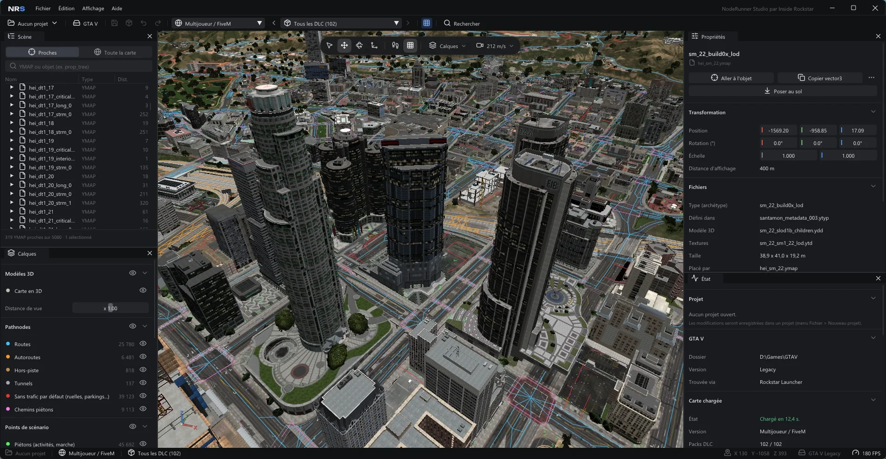
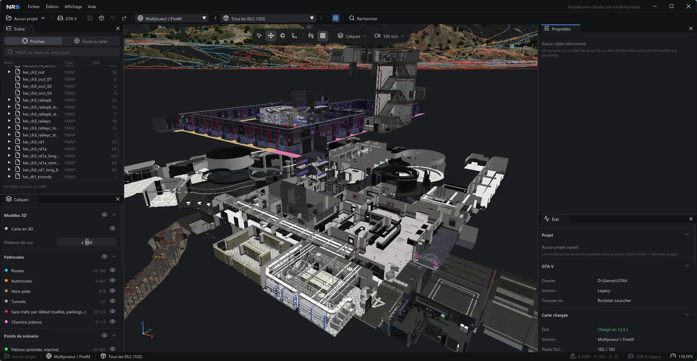

# NodeRunner Studio

**Français** · [English](README.en.md)

**La carte de GTA V en 3D, pour la regarder, la comprendre et la modifier. Gratuit, portable, pensé pour le mapping FiveM.**

<p align="center">
  <a href="https://github.com/HypnoZDev/NodeRunner/releases/download/v1.0.1/NodeRunner-1.0.0-win-x64.zip">
    
  </a>
  <br>
  <sub>Windows 10 / 11 64 bits · ZIP portable, rien à installer · <a href="https://github.com/HypnoZDev/NodeRunner/releases">toutes les versions</a></sub>
</p>



Si vous avez déjà fait du mapping pour un serveur FiveM, vous connaissez la routine : chercher le bon YMAP dans
CodeWalker, ajuster un Z au centimètre pour qu'un objet ne flotte pas, recalculer les extents, monter le dossier `stream`
et le `fxmanifest.lua` à la main... puis découvrir en jeu un mur invisible là où on a supprimé un bâtiment.

NodeRunner Studio est né de là. C'est un éditeur de carte qui s'occupe de ces corvées à votre place, avec un vrai moteur
3D (ombres, eau, ciel selon l'heure) pour voir la carte telle qu'elle est.

> NodeRunner Studio est en **bêta** et évolue vite. Il est déjà utilisable pour de vrais projets, mais gardez une copie
> de vos ressources avant d'exporter par-dessus.

---

## Ce qu'il sait faire

**Explorer la carte**
- Toute la carte de GTA V en 3D, avec les vrais modèles, textures, intérieurs (MLO), niveaux de détail, eau, ombres du
  soleil et cycle jour / nuit.
- La carte telle qu'elle était après n'importe quel DLC, en version FiveM / multijoueur ou solo.
- Une recherche `Ctrl+K` qui trouve tout : un objet, un YMAP, un type, un hash (`0x...`) ou des coordonnées collées
  depuis un script (`vector3(...)`, `vector4(...)`).
- Des calques pour voir ce qui est normalement invisible : pathnodes (trafic), navmesh (piétons), points de scénario,
  collisions, salles et portails des intérieurs.
- Un **explorateur d'archives** : tous les fichiers du jeu (archives RPF, DLC compris) en arborescence, recherche par
  nom, modèle ouvert dans la visionneuse, YMAP retrouvé sur la carte, fichiers texte affichés, extraction sur le disque.



**Modifier**
- Cliquez sur un objet, déplacez-le, tournez-le ou changez sa taille avec les poignées 3D (Ctrl pour aller par crans).
- **Poser au sol** en une touche (Fin) : l'objet se pose sur la vraie collision du jeu, intérieurs compris.
- Sélection multiple, copier / coller (`Ctrl+C` / `Ctrl+V`), annuler / rétablir sans limite.
- Ajout de n'importe quel objet du jeu, choisi dans la visionneuse de modèles (qui montre aussi les véhicules).
- **Suppression propre** : l'objet part avec ses niveaux de détail, sa collision et ses boîtes d'occlusion. Plus de mur
  invisible ni de bâtiment fantôme au loin. Un aperçu montre tout ce qui va partir avant de confirmer.
- Entity sets des intérieurs (mobilier des appartements, bunkers, clubs...) à afficher en direct, avec les lignes de
  script prêtes à copier.

**Exporter vers FiveM**
- Un bouton, et votre ressource est prête : `fxmanifest.lua`, dossier `stream`, boîtes des YMAP recalculées.
- Avant l'export, NodeRunner vérifie si une autre ressource de votre serveur modifie déjà les mêmes fichiers (le fameux
  conflit où la dernière ressource chargée gagne sans prévenir).
- Positions copiées en un clic au format Lua (`vector3` / `vector4` avec le cap), JSON ou C#.
- Un projet par ressource : vos modifications sont enregistrées dans leur dossier et reprises à la prochaine ouverture.

---

## Télécharger

**[Télécharger la dernière version (ZIP)](https://github.com/HypnoZDev/NodeRunner/releases/download/v1.0.1/NodeRunner-1.0.0-win-x64.zip)**
· les autres versions sont sur la page [Releases](https://github.com/HypnoZDev/NodeRunner/releases).

1. Téléchargez le fichier `NodeRunner-x.y.z-win-x64.zip`.
2. Décompressez-le où vous voulez (Bureau, clé USB...). Rien à installer, pas même .NET.
3. Lancez `NodeRunner.exe`.

NodeRunner trouve tout seul votre installation de GTA V (Steam, Epic Games ou Rockstar Games Launcher). Sinon, il vous
demande le dossier. Un écran de démarrage s'affiche le temps de charger la carte.

**Il vous faut :**
- Windows 10 ou 11 en 64 bits ;
- une carte graphique compatible DirectX 11 ;
- GTA V installé sur le PC. NodeRunner est développé sur la version « Legacy » ; la version « Enhanced » est reconnue
  mais pas encore testée de bout en bout.

## Premiers pas

| Pour... | Faites... |
| :--- | :--- |
| Regarder autour | maintenir le clic droit et bouger la souris |
| Se déplacer | `Z` `Q` `S` `D` (ou `W` `A` `S` `D`, ou les flèches), `Shift` pour aller plus vite |
| Monter / descendre | `Espace` ou `E` / `C` |
| Sélectionner un objet | clic gauche (`Ctrl` + clic pour en ajouter) |
| Changer d'outil | `1` sélection, `2` déplacer, `3` tourner, `4` échelle |
| Poser l'objet au sol | `Fin` |
| Chercher n'importe quoi | `Ctrl+K` |
| Enregistrer | `Ctrl+S` |

Ensuite : **Fichier > Exporter en ressource FiveM**, choisissez le dossier `resources` de votre serveur, ajoutez la ligne
`ensure` affichée dans votre `server.cfg`, et c'est en jeu.

---

## Ce que NodeRunner ne fait pas

- **Rien pour GTA Online.** Solo et FiveM uniquement, aucun contournement d'anti-triche.
- **Aucun fichier du jeu n'est fourni.** Le logiciel lit uniquement votre propre installation de GTA V.
- **Pas de version payante.** NodeRunner Studio est gratuit, sans fonctions réservées aux donateurs ni accès anticipé.

## Et ensuite ?

Au programme : import de modèles faits avec Sollumz (et création des `.ytyp`), fusion des ressources en conflit, pack
pour le mode solo, calques des lumières et de l'occlusion, et un mode cinématique pour tourner des vidéos de la carte
(format vertical compris). Le détail est dans le [cahier des charges](docs/cahier-des-charges.md).

Un bug, une idée ? Ouvrez une [issue](https://github.com/HypnoZDev/NodeRunner/issues), avec une capture d'écran et la
position (bouton « Copier la position » du panneau Propriétés) si c'est un souci sur la carte.

---

## Compiler soi-même

Il faut le [SDK .NET 10](https://dotnet.microsoft.com/download/dotnet/10.0) et Git.

```powershell
git clone https://github.com/HypnoZDev/NodeRunner.git
cd NodeRunner
dotnet run --project src/NodeRunner.App
```

Pour fabriquer le ZIP portable : `./build/publish.ps1`.

---

## Licence

NodeRunner Studio est **gratuit**, et son code est publié ici pour la transparence. Il est sous licence
[PolyForm Strict 1.0.0](LICENSE.md) :

- vous pouvez lire le code et utiliser le logiciel gratuitement, pour tout usage non commercial (mapping, serveur FiveM
  communautaire, études, loisirs) ;
- vous ne pouvez pas le redistribuer, le vendre, ni en publier une version modifiée sans l'accord de l'auteur.

Pour partager NodeRunner Studio, partagez le lien de cette page.

Le nom **NodeRunner Studio** et le logo **NRS** appartiennent à **Inside Rockstar** et ne peuvent pas être réutilisés
pour un autre projet.

---

## Crédits

NodeRunner Studio est créé par **Inside Rockstar**.

Merci à **dexyfex** et aux contributeurs de **CodeWalker** (https://github.com/dexyfex/CodeWalker), et plus largement
à la communauté du modding de GTA V, dont le travail de documentation des formats du jeu a rendu ce projet possible.
NodeRunner lit les fichiers du jeu avec son propre code.

Également utilisés :
- **Dear ImGui** (Omar Cornut, licence MIT) via **ImGui.NET** (Eric Mellino, licence MIT) pour l'interface ;
- **Vortice.Windows** (Amer Koleci, licence MIT) pour DirectX 11 ;
- **Lucide** (lucide.dev, licence ISC ; icônes issues de Feather par Cole Bemis, licence MIT) pour les icônes ;
- la police **Unbounded** (The Unbounded Project Authors, SIL Open Font License 1.1) pour le logo.

Les licences des polices sont jointes dans `src/NodeRunner.App/Assets/Fonts/`.

> NodeRunner Studio et Inside Rockstar ne sont affiliés ni à Rockstar Games ni à Take-Two Interactive.
> Grand Theft Auto et GTA sont des marques de Take-Two Interactive.
