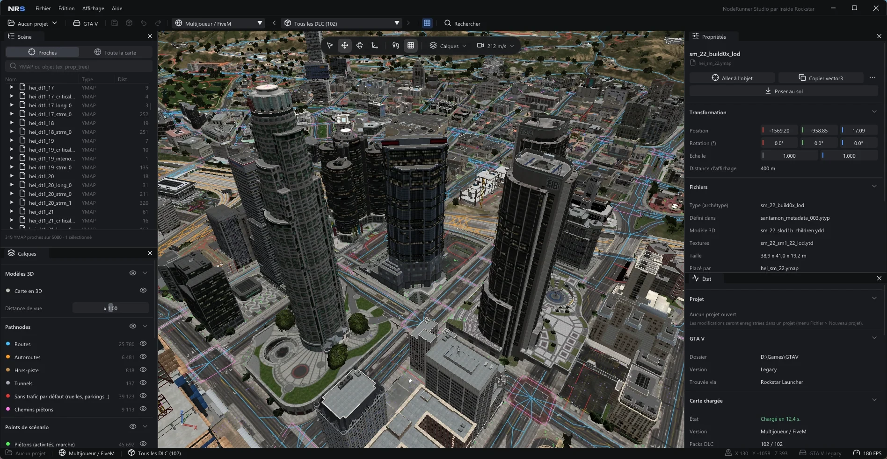
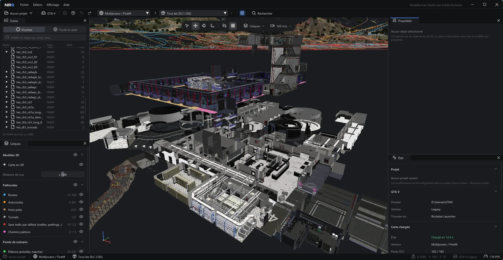

<h1 align="center">NodeRunner Studio</h1>

<p align="center"><strong>Construisez votre Los Santos.</strong><br>Créez, modifiez, explorez et testez vos mappings GTA V dans un seul studio 3D.</p>

<p align="center">
  <a href="https://github.com/HypnoZDev/NodeRunner/releases/latest"></a>
</p>
<p align="center">
  <a href="https://github.com/HypnoZDev/NodeRunner/releases/latest"></a>
  
  
  
  
</p>
<p align="center"><strong>Français</strong> · <a href="README.en.md">English</a> · <a href="https://github.com/HypnoZDev/NodeRunner/releases">Historique des versions</a></p>



**Imaginez :** vous ouvrez GTA V dans NodeRunner, vous déplacez un bâtiment, créez un intérieur, posez votre mobilier à la souris et retirez les collisions gênantes. Vous appuyez sur Play pour parcourir votre création à pied. Puis vous la retrouvez directement dans FiveM grâce au lien avec votre serveur de test.

Moins d'allers-retours entre les outils. Moins de manipulations manuelles. Plus de temps pour créer.

> **NodeRunner Studio 2.0 — le mapping prend une nouvelle dimension.** Gratuit pour un usage non commercial, portable, sans installation et disponible en français et en anglais.

---

## Les nouveautés qui changent votre workflow

| | |
| :--- | :--- |
| **🎮 Votre mapping, directement dans FiveM**<br>Reliez NodeRunner à votre serveur local de développement. Suivez la caméra du jeu, téléportez votre personnage et prévisualisez les modifications en direct. Exportez et rechargez la ressource depuis l'éditeur. | **🚶 Testez votre création en mode Play**<br>Marchez, courez, sautez, nagez et escaladez avec un personnage de GTA V. Les collisions et l'occlusion permettent de repérer les passages bloqués et les objets qui disparaissent. |
| **🌅 Un nouveau moteur 3D**<br>HDR, TAA, occlusion ambiante, lumières nocturnes, ciel réaliste, météo, vagues et surfaces mouillées. Reflets ray tracing sur les GPU compatibles. | **🏗️ Des LOD générés à l'export**<br>Les gros objets éligibles ajoutés à votre mapping peuvent recevoir automatiquement un modèle simplifié et les liens LOD correspondants. |
| **🧩 Votre atelier de props**<br>Créez un prop avec relief et collision depuis une image, modifiez un modèle ou ses textures, puis enregistrez-le comme un nouveau prop. | **🔁 Blender, Sollumz et CodeWalker**<br>Importez des XML compatibles et surveillez un dossier d'export Blender. Exportez aussi les assets du jeu en XML, avec leurs textures DDS, pour poursuivre le travail dans vos outils préférés. |
| **👥 Mappez à plusieurs**<br>Jusqu'à cinq personnes sur un projet, avec modifications, sélections et caméras synchronisées. Rejoignez la session avec un code. | **🛡️ Exportez avec des vérifications**<br>Détectez les conflits entre ressources, les dépendances manquantes, les erreurs MLO et les fichiers trop volumineux avant ou après l'export. |

<p align="center"><a href="https://github.com/HypnoZDev/NodeRunner/releases/tag/v2.0.0"><strong>Découvrir toutes les nouveautés de la 2.0 →</strong></a></p>

## Du premier prop au mapping en jeu

| 1. Explorer | 2. Construire | 3. Tester | 4. Déployer |
| :--- | :--- | :--- | :--- |
| Trouvez un YMAP, un modèle, un hash ou des coordonnées avec `Ctrl+K`. | Placez vos props, éditez vos MLO, routes et collisions. | Parcourez votre création avec le mode Play ou Game Link. | Exportez une ressource FiveM et contrôlez ses dépendances. |

### Un vrai atelier pour vos intérieurs



Créez un MLO, dupliquez un intérieur ailleurs sur la carte, gérez ses salles, ses portails, son mobilier et ses entity sets. Configurez son audio et inspectez les erreurs de structure avant l'export.

**Un bâtiment fermé ?** L'outil expérimental *Ouvrir un bâtiment* peut découper une ouverture dans le modèle et sa collision, avec une pièce simple derrière. Vous pouvez ensuite affiner la création dans l'atelier.

## Tout ce dont un mapper a besoin, au même endroit

<details open>
<summary><strong>🗺️ Explorer et modifier la carte</strong></summary>

- Toute la carte GTA V, modèles et textures du jeu, DLC, niveaux de détail et mode solo ou multijoueur.
- Sélection multiple, transformations 3D, crans, copier/coller, annuler/rétablir et historique des modifications.
- Placement à la souris sur le sol, un toit, une table ou un mur ; rotation à la molette et alignement sur les collisions.
- Suppression assistée des objets avec aperçu des LOD, collisions et occlusions concernés.
- Calques YMAP, collisions, navmesh, routes, scénarios, intérieurs et autres éléments techniques.
- Visionneuse de modèles, véhicules, personnages, animations et cinématiques ; recherche, favoris et accès aux instances sur la carte.
- Explorateur d'archives RPF : recherche, lecture et extraction des fichiers de votre installation.

</details>

<details>
<summary><strong>🏢 MLO, collisions, portes et occlusion</strong></summary>

- Création, placement et duplication d'intérieurs ; édition des salles, portails, entités et entity sets.
- Audio des intérieurs : ambiance, écho, occlusion entre salles et données générées à l'export.
- Diagnostic de santé des MLO : portails invalides, salles sans portail, modèles manquants et autres incohérences.
- Édition YBN : sélection, suppression, matériaux, flags de surface et ajout de triangles ou rectangles.
- Occlusion : visualisation, modification, création assistée de boîtes et aperçu de ce qu'elles masquent.
- Portes : remplacement, arc d'ouverture, vérifications, scripts FiveM et configuration qb-doorlock à copier.

</details>

<details>
<summary><strong>🚦 Routes, scénarios et vie du monde</strong></summary>

- Édition des routes YND : nœuds, liens, voies, vitesse et trafic.
- Création et modification des points de scénario, horaires, probabilités, chaînes et ensembles.
- Car generators, zones de timecycle et lumières LOD modifiables.
- Visualisation et vérification du navmesh YNV (édition YNV pas encore disponible).
- Simulation de vie sur les points de scénario ; lecture des enregistrements de véhicules YVR.
- Visionneuse AWC avec écoute, forme d'onde et export WAV ; visualisation des zones audio.

</details>

<details>
<summary><strong>🛠️ Atelier de modèles, bibliothèque et outils externes</strong></summary>

- Retirez, déplacez, dupliquez ou ajoutez des morceaux de modèles ; remplacez ou redimensionnez les textures.
- Créez un nouveau prop indépendant sans remplacer son modèle d'origine dans le jeu.
- Générez des plaques ou logos 3D avec relief et collision à partir d'une image.
- Bibliothèque de props partagée, packs ZIP/dossiers, miniatures, catégories, favoris et glisser-déposer.
- Import de mappings FiveM et de packages OIV compatibles ; rapport d'import et dépendances manquantes.
- Import XML compatible Sollumz / CodeWalker : YDR, YTD, YBN, YTYP et YMAP.
- Export XML : YDR, YDD, YFT, YTD, YBN, YMAP et YTYP, avec DDS selon le type de ressource.
- Dossier Sollumz surveillé pour recharger les nouveaux exports Blender dans le projet.

</details>

<details>
<summary><strong>📦 Export, validation et collaboration</strong></summary>

- Ressource FiveM : génération du `fxmanifest.lua`, dossier `stream`, recalcul des extents et LOD automatiques pour les objets éligibles.
- Vérifications pré-export : conflits entre ressources, routes, scénarios, navmesh et intérieurs.
- Vérifications post-export : fichiers manquants, doublons, dépendances et ressources trop volumineuses.
- Vérification d'une ressource FiveM existante, indépendamment du projet ouvert.
- Export solo en `dlc.rpf`, projets multiples, copie des positions en Lua/JSON/C#.
- Online en bêta : cinq participants maximum, l'hôte enregistre ; sélections et caméras synchronisées.
- Copie de secours des modifications, raccourcis personnalisables et mise à jour automatique.

</details>

<details>
<summary><strong>🌦️ Rendu 3D et autres GTA</strong></summary>

- Éclairage HDR, anticrénelage TAA, occlusion ambiante, bloom, ombres et lumières nocturnes.
- Météo, nuages volumétriques, pluie, neige, orages, surfaces mouillées et eau animée.
- Reflets ray tracing DXR en option sur matériel compatible (couleur moyenne des textures dans les reflets à ce stade).
- Quatre préréglages graphiques, résolution de rendu, netteté et réglages de caméra.
- GTA IV et ses épisodes, GTA III, Vice City et San Andreas d'origine sur PC : exploration **en lecture seule**.

</details>

---

## Télécharger et commencer

**[⬇ Télécharger la dernière version de NodeRunner Studio](https://github.com/HypnoZDev/NodeRunner/releases/latest)**

1. Téléchargez le fichier `NodeRunner-x.y.z-win-x64.zip` depuis la dernière release.
2. Décompressez-le dans un dossier de votre choix.
3. Lancez `NodeRunner.exe`. Le studio détecte votre installation GTA V ou vous demande son emplacement.

Aucune installation de .NET supplémentaire n'est nécessaire. Les mises à jour peuvent ensuite être lancées depuis NodeRunner ; enregistrez toujours vos modifications avant.

| Configuration | Prérequis |
| :--- | :--- |
| Système | Windows 10 ou 11, 64 bits |
| Graphismes | Carte compatible DirectX 11 ; DXR facultatif pour les reflets ray tracing |
| Jeu | Votre propre installation de GTA V (Steam, Epic ou Rockstar Games Launcher) |
| Compatibilité | Legacy : version de développement principale. Enhanced : détecté, pas entièrement validé. |

### Les raccourcis à connaître

| Action | Raccourci par défaut |
| :--- | :--- |
| Recherche globale | `Ctrl+K` |
| Regarder / se déplacer | Clic droit + souris / `ZQSD` ou `WASD` |
| Monter / descendre | `Espace` ou `E` / `C` |
| Sélectionner, déplacer, tourner, mettre à l'échelle | `1` / `2` / `3` / `4` |
| Poser au sol | `Fin` |
| Mode Play | `Alt+P`, puis `Échap` pour revenir |
| Enregistrer | `Ctrl+S` |

Les raccourcis sont modifiables, avec un préréglage CodeWalker. Pour exporter : **Fichier > Exporter en ressource FiveM**, sélectionnez le dossier `resources` de votre serveur et ajoutez la ligne `ensure` proposée dans `server.cfg`. Pour Game Link, utilisez **Outils > Lien avec le jeu (FiveM)** sur votre serveur local de test.

> [!IMPORTANT]
> NodeRunner Studio est en bêta. Gardez une sauvegarde indépendante de vos projets et ressources, puis testez vos exports en jeu avant déploiement. Les modèles Enhanced, tissus et vitres destructibles ne sont pas entièrement pris en charge par l'export XML. Le mode Play est disponible pour GTA V ; il ne remplace pas une validation dans FiveM.

## Une question, un bug, une idée ?

Le studio évolue grâce aux retours des mappeurs. [Signalez un bug ou proposez une fonctionnalité](https://github.com/HypnoZDev/NodeRunner/issues). Pour un problème sur la carte, indiquez la version de NodeRunner, votre version du jeu, la position et une capture d'écran. Retrouvez les changements détaillés dans les [releases](https://github.com/HypnoZDev/NodeRunner/releases) et le [cahier des charges](docs/cahier-des-charges.md).

Si NodeRunner vous aide à créer vos mappings, une étoile sur GitHub et le partage de cette page aident le projet à se faire connaître.

## Compiler depuis les sources

Avec le [SDK .NET 10](https://dotnet.microsoft.com/download/dotnet/10.0) et Git :

```powershell
git clone https://github.com/HypnoZDev/NodeRunner.git
cd NodeRunner
dotnet run --project src/NodeRunner.App
```

Pour produire le ZIP portable : `./build/publish.ps1`.

## Licence et crédits

NodeRunner Studio est créé par **Inside Rockstar**. Le logiciel est gratuit, sans fonctionnalités payantes ou réservées aux donateurs. Son code est publié pour la transparence sous licence [PolyForm Strict 1.0.0](LICENSE.md) : utilisation non commerciale uniquement ; pas de redistribution, vente ou publication de versions modifiées sans autorisation. Le nom NodeRunner Studio et le logo NRS appartiennent à Inside Rockstar. Pour partager le logiciel, partagez cette page.

Aucun fichier du jeu n'est fourni. NodeRunner lit les fichiers de votre installation avec son propre code. Destiné au mode histoire et à FiveM, il ne propose rien pour GTA Online ni de contournement d'anti-triche.

Merci à **dexyfex**, aux contributeurs de [CodeWalker](https://github.com/dexyfex/CodeWalker) et à la communauté du modding GTA V pour leur travail de documentation des formats.

Bibliothèques et ressources utilisées : Dear ImGui (Omar Cornut, MIT), ImGui.NET (Eric Mellino, MIT), Vortice.Windows (Amer Koleci, MIT), DirectX Shader Compiler (Microsoft, University of Illinois / NCSA), Lucide (ISC, icônes issues de Feather par Cole Bemis, MIT), et Unbounded (The Unbounded Project Authors, SIL Open Font License 1.1). Les licences des polices sont jointes dans `src/NodeRunner.App/Assets/Fonts/`.

> NodeRunner Studio et Inside Rockstar ne sont affiliés ni à Rockstar Games ni à Take-Two Interactive. Grand Theft Auto et GTA sont des marques de Take-Two Interactive.
